# Testes Caixa Cinza em API de Autenticação do Supabase

**Aluno:** João Vitor Carvalho de Oliveira
**RA:** 250862

---

## Estrutura do Repositório

```
/planilha/
/postman/
/prints/      
/README.md      
  
```

---

# Introdução

Este repositório documenta a execução de testes de caixa cinza em uma API de autenticação do Supabase. Para isso, foi criado um projeto no Supabase com autenticação por e-mail e senha, e foram obtidas a URL e a chave de API (API Key) do projeto. Em seguida, as requisições foram montadas e executadas no Postman, cobrindo cinco cenários:

- Login válido
- Senha incorreta
- Usuário inexistente
- Campos vazios
- Credenciais inválidas

# Objetivo da Atividade

Aplicar testes de caixa cinza em uma API de autenticação, utilizando o Supabase como provedor e o Postman como ferramenta de testes, com os seguintes objetivos:

- Compreender o funcionamento de requisições HTTP
- Configurar um ambiente de autenticação no Supabase e criar usuários para teste
- Executar testes funcionais no Postman
- Validar status HTTP, respostas JSON, mensagens de erro e o *access token*
- Documentar tecnicamente todo o processo realizado

---

# Configuração do Supabase

## Criação do projeto

1. Foi criada uma conta no Supabase.
2. Foi criado um novo projeto: **teste_caixa_cinza**.
3. Provedor de autenticação email foi habilitado.

## Tipo de autenticação

Foi utilizada a autenticação por **e-mail e senha**, na qual o cliente envia as credenciais ao endpoint de autenticação e recebe, em caso de sucesso, um *access token* para acessar recursos protegidos.

## Criação do usuário de teste

O usuário foi criado manualmente com o e-mail **joaosantz2006@gmail.com** e uma senha definida por mim.

## Credenciais da API

| Informação | Descrição |
|---|---|
| API URL | https://ruqtubadssmtmtiplurq.supabase.co |
| API Key | sb_publishable_dOmxAJvkbO1t3wPg3zZhsQ_bBdfgFb2 |

## Evidências

| Evidência | Print |
|---|---|
| Projeto criado | 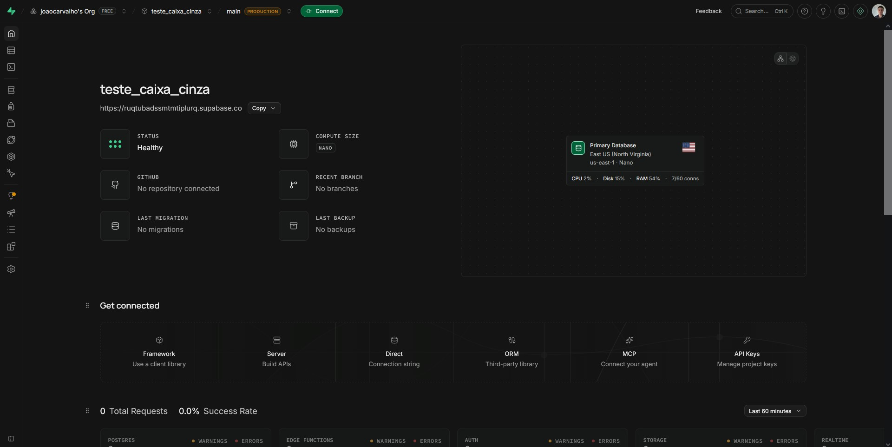 |
| Autenticação por e-mail habilitada | 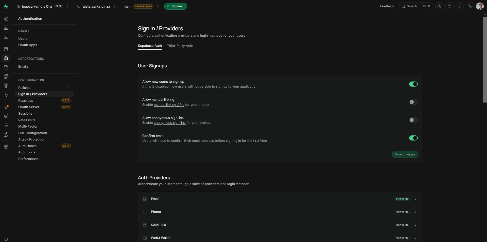 |
| Usuário criado | 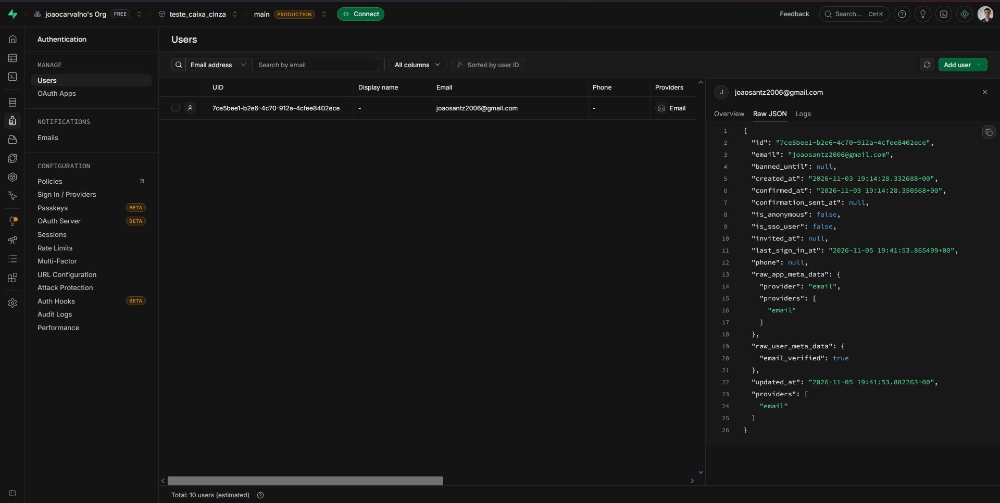 |
| Credenciais da API (chave ocultada) | 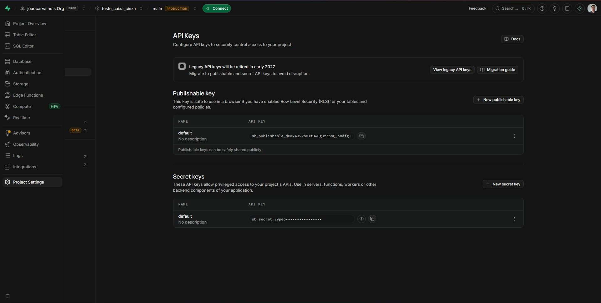 |
| Identificação do aluno no ambiente | 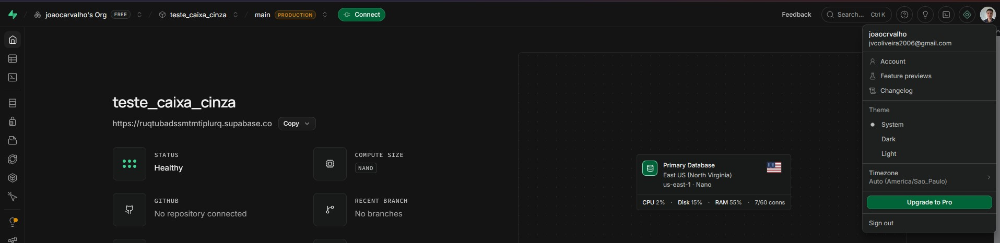 |

---

# Configuração do Postman

## Workspace e Collection

No Postman Desktop foi criado um Workspace chamado **My workspace**, que agrupa a collection e o environment desta atividade.

## Environment

Foi criado um Environment para armazenar os dados de conexão em variáveis, evitando repetir valores em cada requisição:

| Variável | Descrição |
|---|---|
| `base_url` | URL da API do Supabase |
| `api_key` | API Key do projeto |
| `email` | E-mail do usuário criado para teste |
| `password` | Senha do usuário criado para teste |
| `access token` | Access token obtido após requisição com login válido |

## Finalidade das variáveis e uso do Postman

As variáveis tornam as requisições reutilizáveis e fáceis de manter: se a URL, a chave ou o usuário mudarem, basta alterar o Environment. O Postman foi utilizado para montar a requisição de login, enviar os diferentes conjuntos de dados de entrada e analisar o status HTTP, o corpo da resposta e as mensagens de erro de cada cenário.

## Evidências

| Evidência | Print |
|---|---|
| Workspace criado | 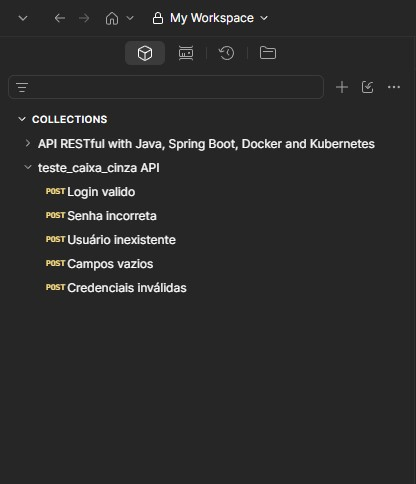 |
| Environment criado | 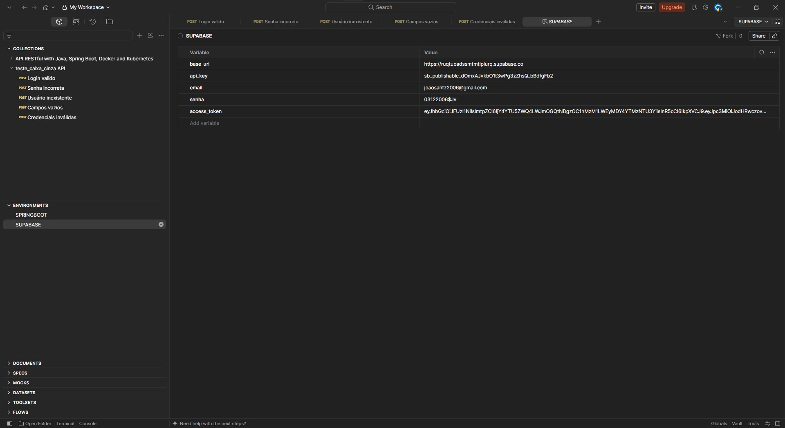 |

---

# Configuração das Requisições

## Dados da requisição

| Item | Valor |
|---|---|
| Endpoint | `{{base_url}}/auth/v1/token?grant_type=password` |
| Método HTTP | `POST` |

## Headers

| Header | Valor |
|---|---|
| `apikey` | `{{api_key}}` |
| `Content-Type` | `application/json` |

## Body JSON

```json
{
  "email": " ",
  "password": " "
}

```

## Evidências

| Evidência | Print |
|---|---|
| Endpoint configurado | 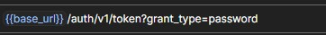 |
| Headers | 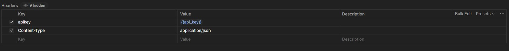 |

---

# Execução dos Testes

Os cinco cenários foram executados com a mesma requisição, alterando apenas os dados do body.

## Descrição dos testes

**1 – Login válido**
- Entrada: `{ "email": "{{email}}", "password": "{{password}}" }`
- Resultado: Status 200 e o access token

**2 – Senha incorreta**
- Entrada: `{ "email": "{{email}}", "password": "1234" }`
- Resultado: Status 400 e mensagem de credenciais inválidas

**3 – Usuário inexistente**
- Entrada: `{ "email": "inexistente@gmail.com", "password": "{{password}}" }`
- Resultado: Status 400 e mensagem de credenciais inválidas

**4 – Campos vazios**
- Entrada: `{ "email": "", "password": "" }`
- Resultado: Status 400 e mensagem de faltando email ou telefone

**5 – Credenciais inválidas**
- Entrada: `{ "email": "joao@gmail.com", "password": "1234" }`
- Resultado:  Status 400 e mensagem de credenciais inválidas

## Evidências

### 1 - Login válido

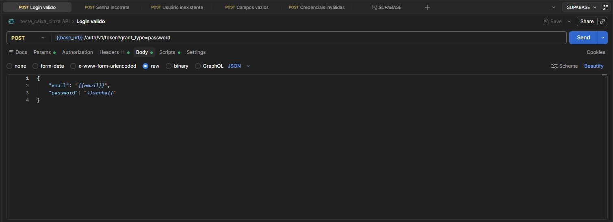

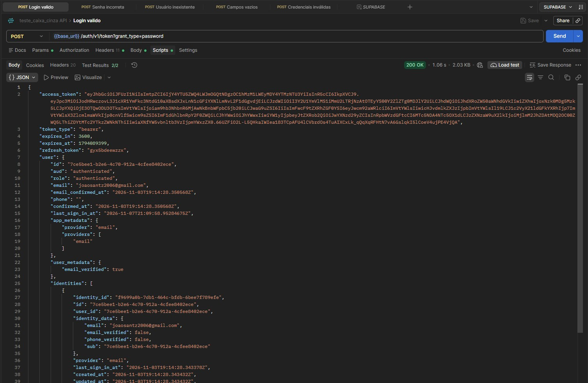


### 2 - Senha incorreta

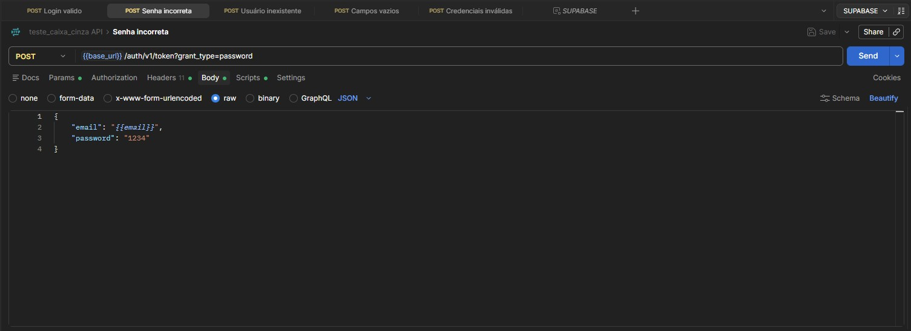
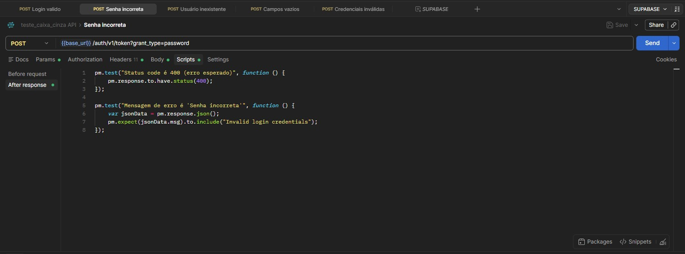

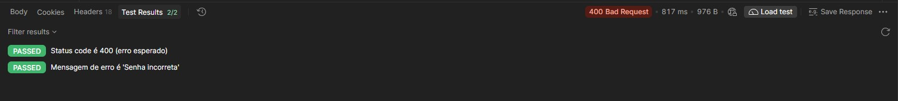

### 3 - Usuário inexistente

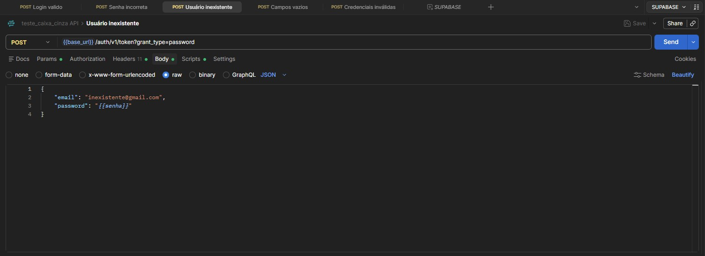
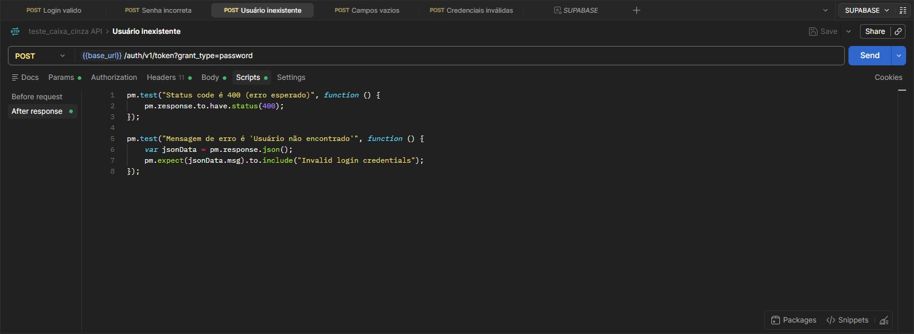

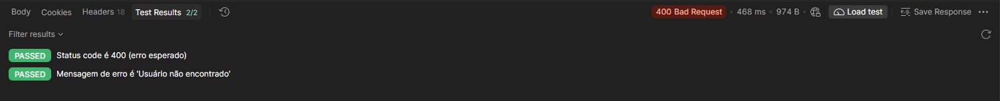

### 4 - Campos vazios

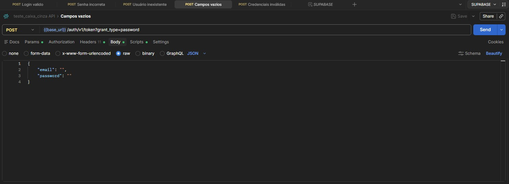
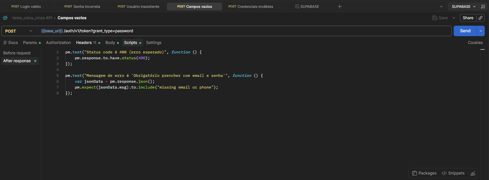

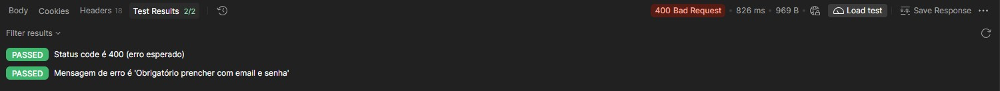

### 5 - Credenciais inválidas 

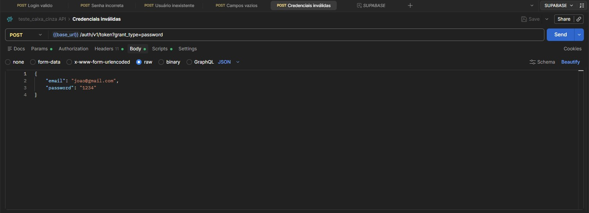
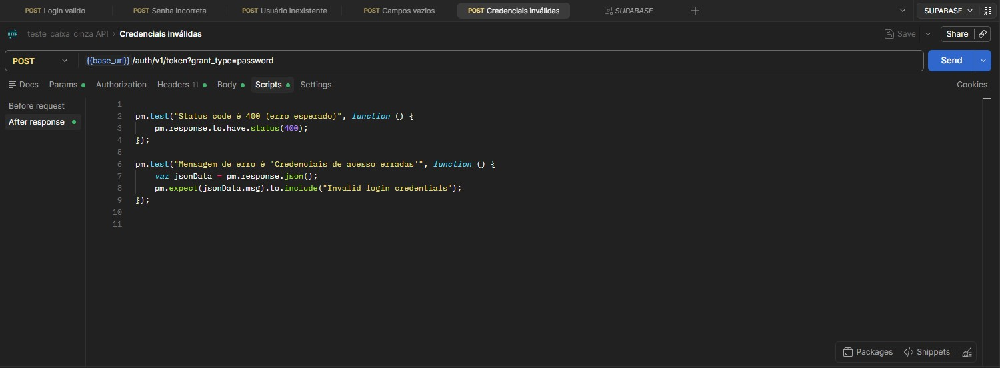

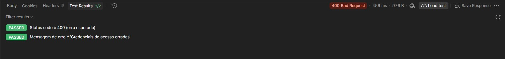

---

# Registro dos Testes

## Como os testes foram registrados

Cada execução foi registrada em uma planilha localizada em `/planilha/`, com os campos: ID, cenário, entrada, resultado esperado, resultado obtido, status (Sucesso/Falha) e observações. A planilha foi preenchida logo após cada execução, com base no que o Postman retornou.

## Importância da documentação dos testes

Registrar os testes permite repetir os cenários, comparar o comportamento esperado com o real, rastrear falhas e dar evidência objetiva de que a API foi validada. Também facilita que outra pessoa entenda e reproduza o trabalho sem depender de quem o executou.

## Evidências

| Evidência | Arquivo |
|---|---|
| Planilha preenchida |  |
| Arquivo da planilha | [planilha/](planilha/) |

---

# Resultados Obtidos

## Resumo

| Total de testes | Sucesso | Falha |
|---|---|---|
| 5 | 5 | 0 |

## Análise

- **Login válido:** Retornou o status 200 que nos possibilitaria entrar na aplicação e o access token
- **Cenários de erro:** Todos os erros retornaram o status 400 o que era esperado
- **Mensagens de erro:** Cada erro retornava uma mensagem específica

---

# Conclusão

Os testes de caixa cinza foram executados no Postman sobre a API de autenticação do Supabase, cobrindo os cinco cenários obrigatórios. Todos os cinco funcionaram e retornaram o esperado

**Dificuldades encontradas:** Nenhuma dificuldade foi encontrada, o maior desafio no entanto foi compreender e escrever scripts corretos

**Falhas identificadas:** Nenhuma.

**Melhorias que poderiam ser implementadas:**

- Incluir mais casos, como e-mail com formato inválido, senha muito curta, caracteres especiais, requisição sem a `apikey` e uso de token expirado
- Validar o tempo de resposta e o limite de tentativas
- Padronizar o registro dos resultados em um relatório gerado automaticamente

**Importância dos testes de caixa cinza em APIs:** Os testes de caixa cinza são importantes porque permitem uma validação mais profunda do que os testes de caixa preta. Como o testador conhece parte da estrutura do sistema (endpoint, headers, formato do body e comportamento esperado das respostas), é possível montar cenários mais precisos, em vez de apenas observar entradas e saídas sem contexto. Isso ajuda a identificar falhas de validação, de tratamento de erros e de segurança, como mensagens que revelam informações demais sobre os usuários cadastrados. Além disso, esse tipo de teste pode ser feito diretamente sobre a API, sem depender de uma interface gráfica, e antes de o sistema ser colocado em produção. Assim, os problemas são encontrados e corrigidos cedo, com menor custo e menor risco para os usuários finais.
